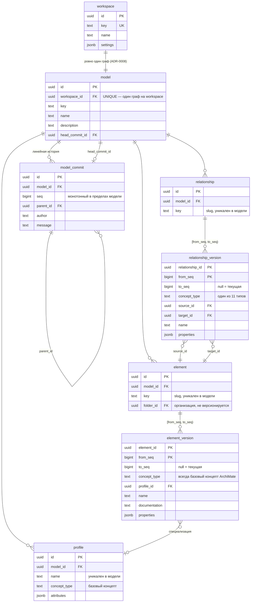
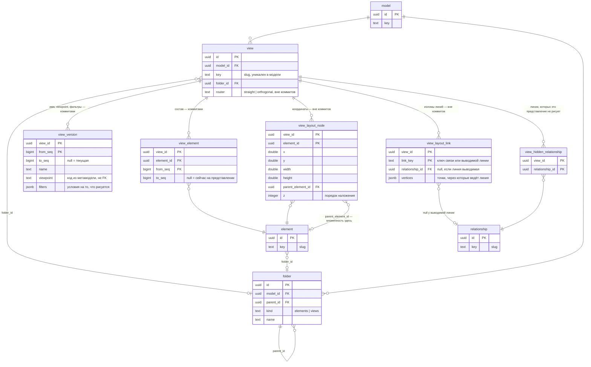

# 07. Схема данных

Текущее состояние базы: миграции `V1`–`V13`, PostgreSQL 18. Диаграмма **производна** от миграций,
а не наоборот: источник правды — `server/archgrid-app/src/main/resources/db/migration/` и
Java-миграция `V10`, и при расхождении прав тот каталог.

Служебная таблица `flyway_schema_history` опущена. Столбцы `created_at`/`updated_at` на диаграмме
не показаны — они есть у `workspace`, `model`, `model_commit`, `profile`, `folder`,
`view_layout_node`, `view_layout_link`, `view_hidden_relationship` и ничего не решают.

## Ядро: репозиторий и его история

Всё, что версионируется коммитами. Таблицы `element`, `relationship` — только идентичность;
изменяемое лежит в `*_version` с интервалом `[from_seq, to_seq)`.



## Представления: определение, оформление, организация

Определение представления версионируется вместе с моделью; всё, что ниже линии `view_version` /
`view_element`, — оформление, живущее вне коммитов, и папки, не значащие ничего для метамодели.



## Три группы таблиц, и граница между ними — главное в этой схеме

**Арендатор и репозиторий.** `workspace` → `model`, и на `model` висит `unique (workspace_id)`:
workspace держит **ровно один связный граф** ([ADR-0008](adr/0008-one-graph-per-workspace.md)).
Это не экономия таблицы, а условие того, что «где используется», анализ влияния и отчёт о дрейфе
отвечают за весь ландшафт, а не изнутри одного из нескольких моделей — и молча врут про остальные.

**Версионируемое коммитами.** `element`, `relationship`, `view` — таблицы идентичности: `id`,
`model_id`, `key`, и больше ничего. Всё, что меняется, живёт в `*_version` с интервалом
`[from_seq, to_seq)` по последовательности коммитов модели:

```
состояние HEAD       ->  where to_seq is null
состояние коммита N  ->  where from_seq <= N and (to_seq is null or to_seq > N)
```

Оба запроса — один индексный проход, без рекурсии и без второй таблицы, которую пришлось бы
держать согласованной в той же транзакции. Материализованные таблицы «текущего состояния» из
наброска в [02-architecture.md](02-architecture.md) §4.2 отменены именно поэтому. Работает это,
пока история линейна; ветвление потребует обхода предков, к которому схема готова
(`model_commit.parent_id`).

`seq` выдаётся под блокировкой строки в `model` — это же и сериализует конкурентные коммиты.
Оптимистичная проверка `baseCommitId` имеет смысл только если два писателя не могут вклиниться
между проверкой и записью ([ADR-0004](adr/0004-commands-and-versioning-from-day-one.md)).

**Не версионируемое — оформление.** `view_layout_node` (координаты, размеры, вложенность на этом
представлении, `z`), `view_layout_link` (изломы линий), `view_hidden_relationship`, `view.router`. Перетаскивание прямоугольника не
порождает коммит, иначе история модели становится нечитаемой
([ADR-0003](adr/0003-model-view-layout-separation.md)). Последняя запись побеждает; цена проигранной
гонки — движение мышью, а не информация.

**Организация.** `folder` — дерево на модель, с `kind` (`elements` или `views`). Папка **ничего не
значит для метамодели**: не влияет ни на валидацию, ни на деривацию, ни на глубину C4, и не
версионируется ([ADR-0009](adr/0009-views-and-folders.md)). Удаление папки поднимает содержимое
наверх, а не удаляет его.

## Правила, которые несут вес

**Двойная идентичность.** У каждого адресуемого объекта есть UUID (на него ссылается система) и
slug (на него ссылаются люди, URL и будущий формат Architecture-as-Code). Команды адресуют объекты
**по slug**: лог команд остаётся читаемым, диффы DSL — осмысленными, предложения AI — исполнимыми.
Регексп slug'а продублирован check-ограничением в базе намеренно: база — последний рубеж перед
плохим импортом.

**Связи представления не хранятся.** Нет таблицы «связи на представлении»: представление рисует те
связи, у которых оба конца на нём. Это то, чего архитектор и ждёт, бросив два элемента рядом, и это
убирает вопрос, что делать со строкой, когда один из концов ушёл. Выводимые связи не хранятся тем
более — они вычисляются при запросе ([ADR-0009](adr/0009-views-and-folders.md)).

**Вложенность живёт в двух местах, и это не дублирование.** «Что чем содержится» — обычная связь
Composition или Aggregation в `relationship_version`. «Что внутри чего нарисовано на этом
представлении» — `view_layout_node.parent_element_id`. Первое — утверждение о системе, второе —
приём представления ([ADR-0011](adr/0011-nesting-is-presentation.md)). Поля `element.parent`
больше нет: миграция `V10` превратила его в строки Composition.

**Правила удаления сказаны явно.** Почти везде `on delete cascade` — удаление workspace уносит
модель целиком. Два исключения: `folder_id` у элемента и представления — `set null` (удалили папку,
содержимое осталось), а `element_version.profile_id` — `restrict`: профиль нельзя удалить, пока по
нему типизирован хоть один элемент, включая исторические версии.

**Маршрут линии ключуется линией, а не связью.** `view_layout_link.link_key` — это ключ связи
*или* вычисляемый ключ выводимой линии (`derived:source:type:target`), а `relationship_id` заполнен
только в первом случае и служит для каскадной уборки. Пока ключом был внешний ключ на
`relationship`, изломы выводимых линий редактор принимал, отправлял на сервер и терял: вставке было
не с чем сопоставить строку (миграция V13).

**Один узел на элемент в пределах вида — решение, а не недосмотр.** `view_layout_node` держит
`primary key (view_id, element_id)`, тогда как обменный формат ArchiMate разрешает нарисовать один
элемент на виде дважды. Поддержать это значит завести идентичность диаграммного объекта и протащить
её через весь редактор, где сейчас ключ элемента и есть идентификатор фигуры. Цена решения —
импорт схлопывает дубли и говорит об этом ([ADR-0012](adr/0012-archimate-exchange-format.md)).

**Чего в схеме нет специально.** Столбца «тип C4» — уровень C4 вычисляется как глубина
относительно фокуса представления ([ADR-0007](adr/0007-c4-projection.md)). Таблицы метамодели —
это версионируемый файл, а не данные арендатора ([ADR-0002](adr/0002-metamodel-as-data.md)); поэтому
`view_version.viewpoint` и `*.concept_type` — текст, проверяемый приложением, а не внешние ключи.
